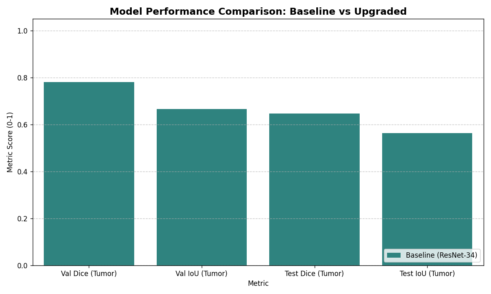

# Brain Tumor Segmentation and Volumetric Delineation

Streamlit front end for 2.5D UNet checkpoints trained on the Kaggle **TCGA-LGG** brain MRI
dataset. It segments tumor regions on axial slices, reports confidence, and — when the dataset
is present — compares each prediction against the ground-truth mask with Dice and IoU.



## Run

```bash
pip install -r requirements.txt
python -m streamlit run app.py
```

On Windows, if Streamlit crashes with `OSError: [WinError 64]`, bind it to IPv4 loopback:

```bash
python -m streamlit run app.py --server.address 127.0.0.1
```

## Tabs

- **Dataset** — browse `archive/kaggle_3m/TCGA_*`, pick a patient and slice, and see
  MRI / ground truth / probability map / GT-vs-prediction side by side with Dice, IoU and
  tumor-area percentages. One click evaluates every tumor slice of the patient and reports
  mean slice Dice plus volume error.
- **Upload** — run the model on your own PNG/JPG/BMP/TIF slices. Several files are treated as
  one volume; slice order is taken from filenames.
- **Training results** — the metrics, learning curves, threshold ablation, per-patient volumes
  and figures saved by the original training runs.
- **Notes & caveats** — architecture, preprocessing contract and a reproducibility check.

## Models

Each run folder holds `config.json`, `best_fold*.pt` and its evaluation artifacts. The checkpoints
are bare `state_dict`s, so the app rebuilds the architecture from the config and reads the input
channel count from the encoder stem, then loads with `strict=True`.

| Run | Encoder | Folds | Notes |
|---|---|---|---|
| `improved_r34_25d` | ResNet-34 | 0–3 | 80 epochs, scSE, Tversky + focal |
| `upgraded_efficientnet_b4` | EfficientNet-B4 | 0 | 100 epochs, cosine restarts |
| `efficientnet_b4_25d` | EfficientNet-B4 | 0–1 | 100 epochs, cosine |

The project has **two model architectures** — ResNet-34 and EfficientNet-B4, both 2.5D U-Net +
scSE. The app offers one checkpoint per architecture (the ResNet-34 run with recorded metrics, and
the EfficientNet-B4 run with its history), because extra folds and the second EfficientNet run are
repeat trainings of the same architecture rather than different models. `upgraded_efficientnet_b4`
stays on disk for reference but is not shipped: it is byte-identical in config to
`efficientnet_b4_25d` and carries no saved metrics.

Input: nine channels = three neighbouring axial slices, tiled. Image size 384 (not recorded in
`config.json`; inferred from the saved overlay tiles). Intensities stay on the 0–255 scale after a
percentile clip — dividing by 255 collapses every prediction to a constant.

## Reproducibility notes

`results.json` records test Dice 0.674 on tumor slices for `improved_r34_25d`. Re-evaluated here
against the dataset masks, the same checkpoints reach about **0.10** slice Dice. That held across
9-channel layouts, three intensity scalings, two input sizes, thresholds 0.1–0.8 and all eight
image orientations, so it is not a preprocessing detail that is still missing — the weights do not
reproduce the reported numbers on this data. The training script was not part of the saved
artifacts.

## Retrain

`train.py` trains the same architecture with a protocol you can defend: grouped 5-fold CV over
patients, the probability threshold chosen on each fold's **validation** split only, and
per-patient Dice3D plus volume error from the same pass, so every patient is scored once.

Smoke test (CPU, ~1 min):

```bash
python train.py --data archive/kaggle_3m --out runs/smoke --folds 1 --epochs 1 \
  --limit-patients 4 --size 192 --batch 2 --max-batches 1 --encoder-weights none
```

Full run (GPU strongly recommended):

```bash
python train.py --data archive/kaggle_3m --out runs/r34_25d --epochs 25
```

On Colab, open `train_colab.ipynb` and run the cells in order. Each run folder gets
`config.json` (with `IMG_SIZE`, spacing, git commit), `history_fold*.csv`, `best_fold*.pt`,
`threshold.json`, `results.json` and `volumetrics.csv`. The app discovers `runs/<name>/`
automatically.

## Report

The written report is generated locally and is **not tracked in this repository** (college
submissions are handed in separately). To rebuild it as a PDF:

```bash
python build_report.py     # writes LPU_Project_Report.pdf
```

## Repository layout

```
app.py                 Streamlit app
train.py               training / evaluation script
train_colab.ipynb      Colab notebook for train.py
requirements.txt       runtime dependencies
ablation_log.csv       threshold / config sweep from the original runs
model_comparison.png   figure saved by the training run
<run>-*/               configs, weights, histories, metrics, figures
runs/                  output of train.py (not committed)
archive/demo/kaggle_3m/ three complete patients, committed so the hosted demo has ground truth
archive/kaggle_3m/     full dataset (not committed — see below)
```

The dataset (~1.1 GB) and the checkpoints (~90 MB each) are excluded from git. Download the
Kaggle *LGG MRI Segmentation* dataset into `archive/kaggle_3m/` and put the `.pt` files back in
their run folders, or track the weights with Git LFS (`git lfs track "*.pt"`).

## Limitations

- No voxel spacing in the configs, so volumes are in pixels, not mm³.
- Predictions depend on slice order; a single uploaded image fills the whole 2.5D window.
- Research demo only, not a diagnostic tool.
